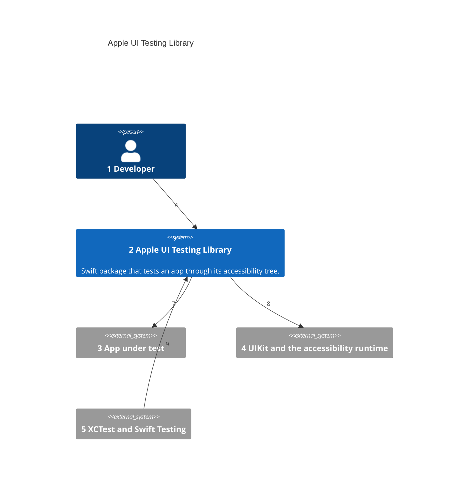
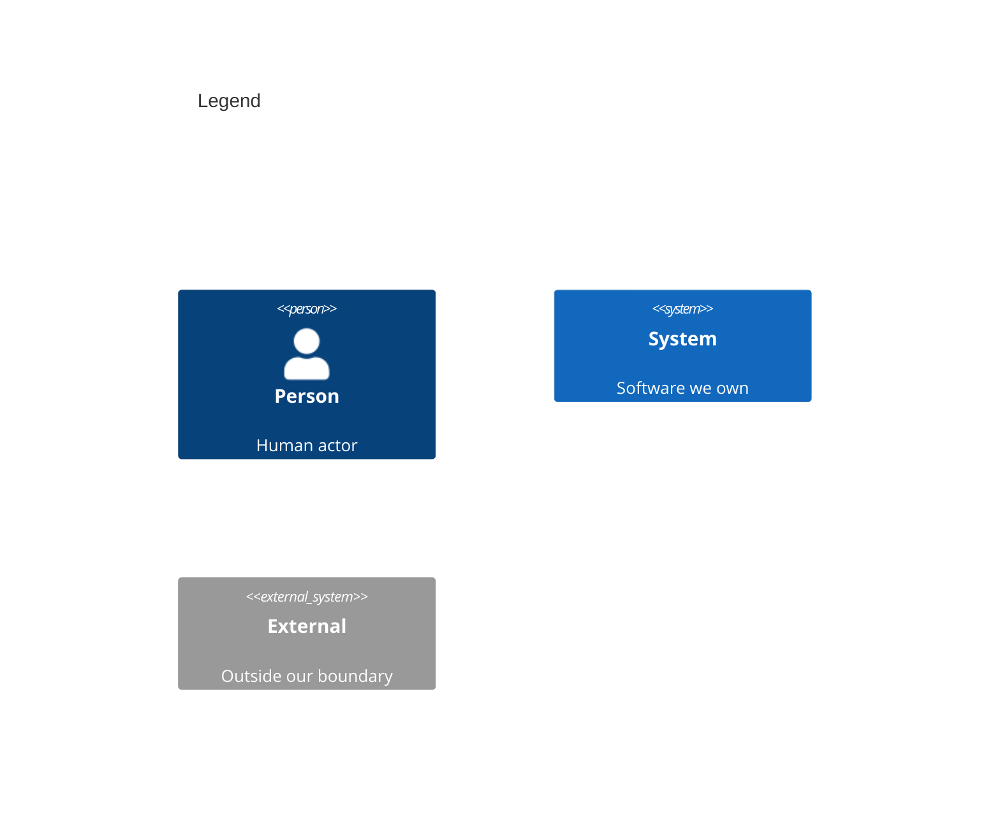

# System Context

Numbers on nodes and arrows match the callout table.

| #   | Description | Why |
| --- | --- | --- |
| 1   | Composes the app root and writes tests that read like a person using it. | Testing Library's second user; the person on screen is the first. |
| 2   | The `UITestingLibrary` module: render, query, act, wait, and report. | One small surface every consumer shares. |
| 3   | The consumer's SwiftUI or UIKit root view. | Its real composition runs, with fakes only at its own seams. |
| 4   | `UIWindow`, `UIHostingController`, and the tree VoiceOver reads. | The same tree a person hears is the one tests read ([ADR 0001](adr/0001-in-process-accessibility-tree.md)). |
| 5   | Apple's test runners, run in the app's process with `xcodebuild`. | Hosted tests share the app's main thread and scene. |
| 6   | Imports the package in test targets only. | The app ships without it. |
| 7   | Draws the root view in a key window of the host app. | No second process and no launch per test. |
| 8   | Turns automation on, reads elements, and drives them. | Activation, custom actions, scrolling, escape, and typing are VoiceOver's entry points. |
| 9   | Runs each test serialized on the main actor. | One key window at a time ([ADR 0005](adr/0005-one-window-per-process.md)). |
