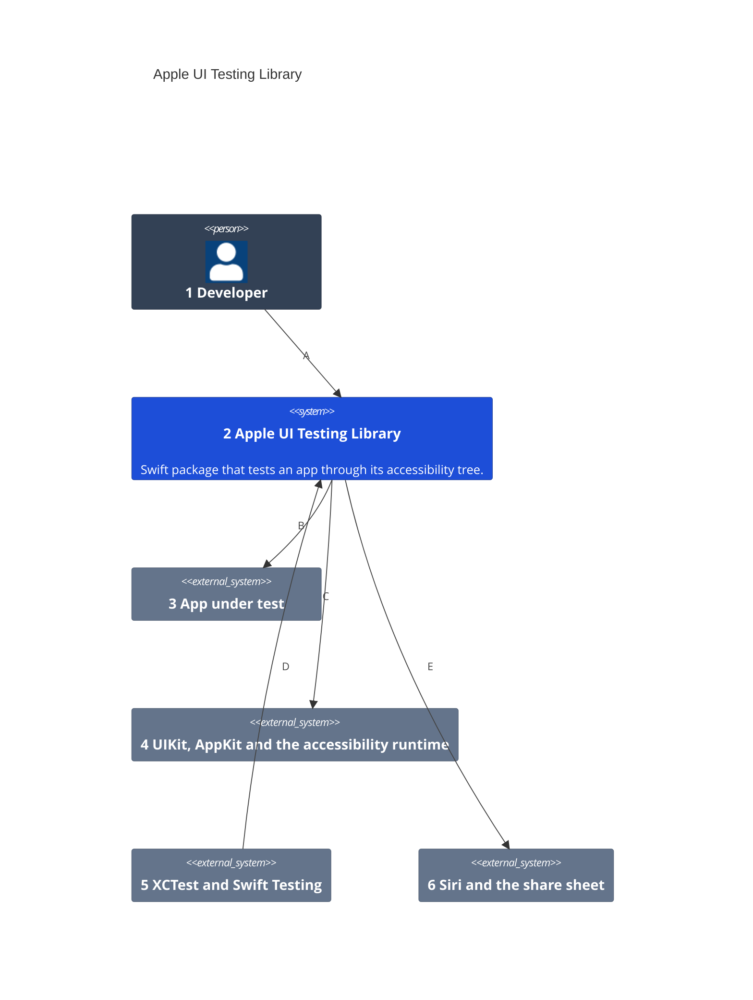
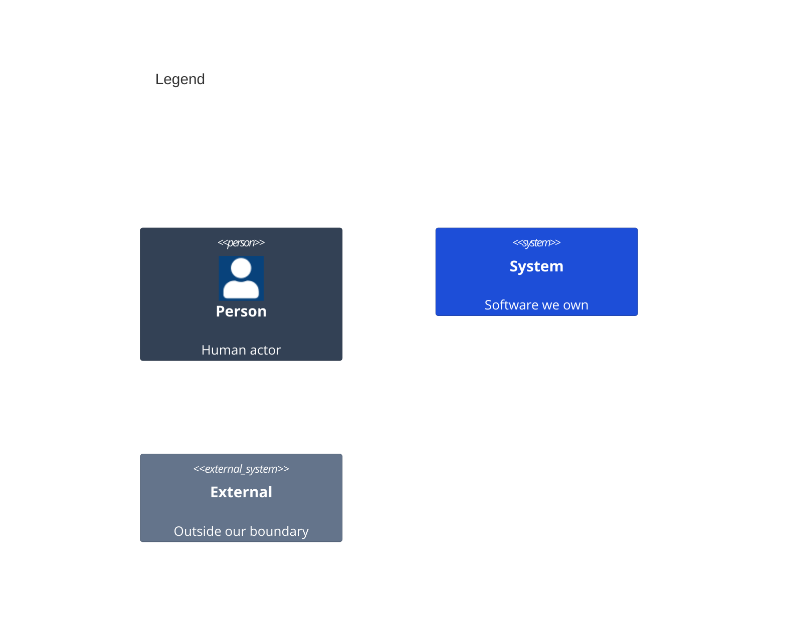

# System Context

Numbers on nodes and letters on arrows match the callout table.

| #   | Description | Why |
| --- | --- | --- |
| 1   | Composes the app root and writes tests that read like a person using it. | Testing Library's second user; the person on screen is the first. |
| 2   | The `UITestingLibrary` product, plus the optional system and share destination products. | One small surface every consumer shares; system UI is opt-in. |
| 3   | The consumer's SwiftUI, UIKit or AppKit root view, on iOS or macOS. | Its real composition runs, with fakes only at its own seams. |
| 4   | `UIWindow` and `UIHostingController` on iOS, `NSWindow` and `NSHostingController` on macOS, and the tree VoiceOver reads. | The same tree a person hears is the one tests read ([ADR 0001](adr/0001-in-process-accessibility-tree.md), [ADR 0006](adr/0006-one-api-two-backends.md)). |
| 5   | Apple's test runners, run with `xcodebuild`. | Hosted tests share the app's main thread and scene; system tests run in their own process. |
| 6   | System UI on an iOS simulator. | Siri answers and shares happen outside the app ([ADR 0008](adr/0008-siri-system-requests.md), [ADR 0009](adr/0009-system-sharing.md)). |
| A   | Imports the package in test targets only. | The app ships without it, except a test build's local share destination. |
| B   | Draws the root view in a key window of the host app, or launches the app for a system test. | Hosted tests need no second process and no launch per test. |
| C   | Turns automation on, reads elements, and drives them. | Activation, custom actions, scrolling, escape, and typing are VoiceOver's entry points. |
| D   | Runs each hosted test serialized on the main actor. | One key window at a time ([ADR 0005](adr/0005-one-window-per-process.md)). |
| E   | Asks Siri and follows a share into a local destination. | Only received answers and bytes prove the result. |
