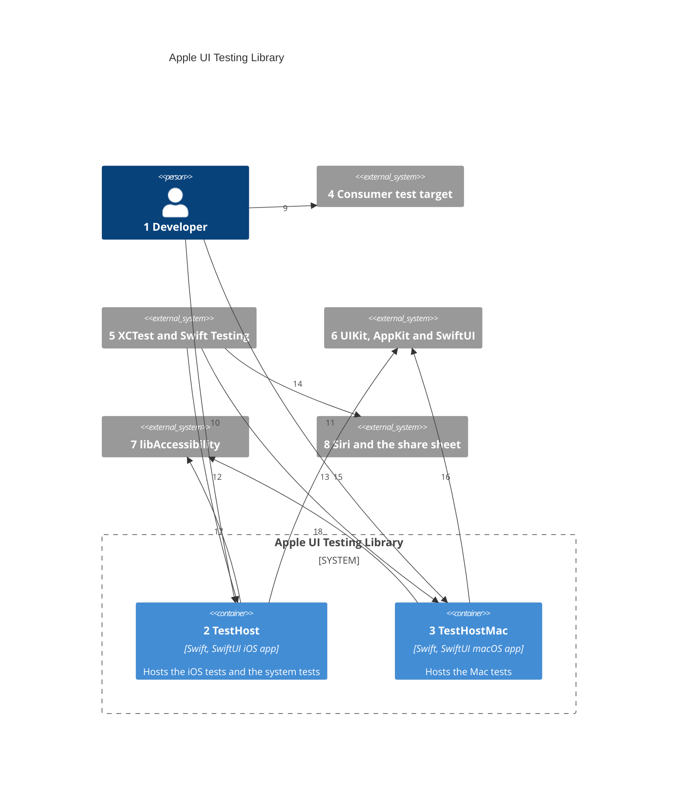
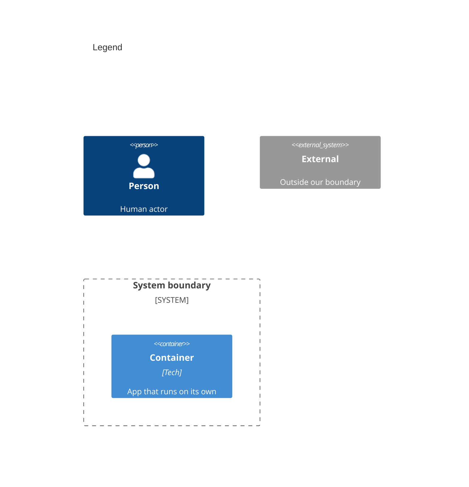

# Containers

A container here is an app that runs on its own. The library products and test bundles run inside these apps, so [03-components.md](03-components.md) shows them.

Numbers on nodes and arrows match the callout table.

| #   | Description | Why |
| --- | --- | --- |
| 1   | Writes tests in a consumer app or in this repo. | Same actor as [01-system-context.md](01-system-context.md). |
| 2   | The iOS app target in `project.yml`. It links the share destination product. | Hosted tests need a running app with a window scene; system tests launch it. |
| 3   | The macOS app target, built from the same SwiftUI sources as the iOS app. | A Mac app's tests need a real AppKit window ([ADR 0006](adr/0006-one-api-two-backends.md)). |
| 4   | A consumer's hosted test bundle, and optionally its UI test bundle. | Consumers add the package through XcodeGen `packages:` with `majorVersion: 1`. |
| 5   | Apple's test runners, driven by `xcodebuild`. | Hosted bundles run in the app's process; the UI test runner is its own process. |
| 6   | Windows, hosting controllers, and the views under test. | The library draws through public UIKit and AppKit API. |
| 7   | `/usr/lib/libAccessibility.dylib`, reached with `dlopen`. | Its private `_AXSSetAutomationEnabled` makes SwiftUI build its tree ([ADR 0004](adr/0004-automation-canary.md)). |
| 8   | System UI outside the app's process, reached on a simulator only. | Hosted actions cannot drive it ([ADR 0008](adr/0008-siri-system-requests.md), [ADR 0009](adr/0009-system-sharing.md)). |
| 9   | The developer writes tests in their own target. | Tests live beside the app they prove. |
| 10  | `make requirements` runs the iOS hosted bundle; `make requirements-e2e` runs the system tests. | System tests are opt-in and boot a simulator. |
| 11  | `make requirements` runs the Mac hosted bundle too. | One API on both platforms. |
| 12  | The iOS hosted bundle runs in the app's process. The system test runner launches the app from its own process. | Hosted tests share the app's main thread; system tests see what a person sees. |
| 13  | The Mac hosted bundle runs in the app's process. | The same hosting a Mac consumer uses. |
| 14  | The system test runner opens Siri and the share sheet through XCTest automation. | Only a separate process can drive system UI. |
| 15  | The iOS app draws each root in a key window through `UIHostingController`. | The real view hierarchy, in-process ([ADR 0001](adr/0001-in-process-accessibility-tree.md)). |
| 16  | The Mac app draws each root through `NSHostingController`. | The same rule on macOS. |
| 17  | The iOS app turns automation on once per process. | Without it the tree comes back empty. |
| 18  | The Mac app turns automation on the same way. | The same rule on macOS. |
