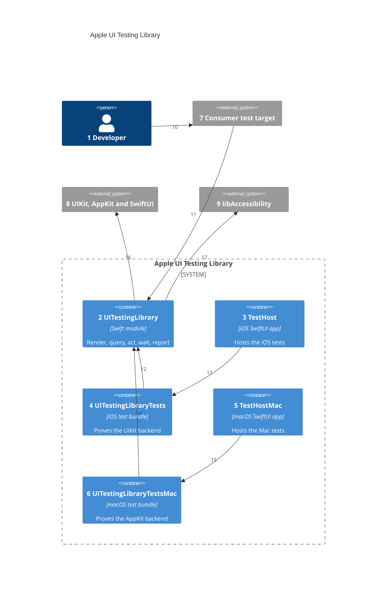

# Containers

Numbers on nodes and arrows match the callout table.

| #   | Description | Why |
| --- | --- | --- |
| 1   | Writes tests in a consumer app or in this repo. | Same actor as [01-system-context.md](01-system-context.md). |
| 2   | `Sources/UITestingLibrary/`, the one library product in `Package.swift`. | One import gives a test everything it needs. |
| 3   | `TestHost`, the iOS app target in `project.yml`, built from `TestHost/`. | Hosted tests need a running app with a window scene. |
| 4   | `UITestingLibraryTests`, the iOS bundle built from `Tests/Shared/` and `Tests/UITestingLibraryTests/`. | The UIKit backend is proven against real SwiftUI screens. |
| 5   | `TestHostMac`, the macOS app target, built from the same `TestHost/` sources. | A Mac app's tests need a real AppKit window ([ADR 0006](adr/0006-one-api-two-backends.md)). |
| 6   | `UITestingLibraryTestsMac`, the macOS bundle built from `Tests/Shared/` and `Tests/UITestingLibraryMacTests/`. | The AppKit backend is proven by the same tests, against the same fixtures. |
| 7   | A consumer's hosted test bundle. | Consumers add the package through XcodeGen `packages:` with `majorVersion: 1`. |
| 8   | Windows, hosting controllers, and the views under test. | The library draws through public UIKit and AppKit API. |
| 9   | `/usr/lib/libAccessibility.dylib`, reached with `dlopen`. | Its private `_AXSSetAutomationEnabled` makes SwiftUI build its tree ([ADR 0004](adr/0004-automation-canary.md)). |
| 10  | The developer writes tests in their own target. | Tests live beside the app they prove. |
| 11  | The consumer target imports `UITestingLibrary`. | Test targets only; the app never links it. |
| 12  | The iOS bundle imports the module. | It uses the public API, as a consumer does. |
| 13  | `TestHost` runs `UITestingLibraryTests` in its process. | The same hosting an iOS consumer uses. |
| 14  | The macOS bundle imports the same module. | One API on both platforms. |
| 15  | `TestHostMac` runs `UITestingLibraryTestsMac` in its process. | The same hosting a Mac consumer uses. |
| 16  | The module draws the root in a key window through the platform's hosting controller. | The real view hierarchy, in-process ([ADR 0001](adr/0001-in-process-accessibility-tree.md)). |
| 17  | The module turns automation on once per process. | Without it the tree comes back empty. |
