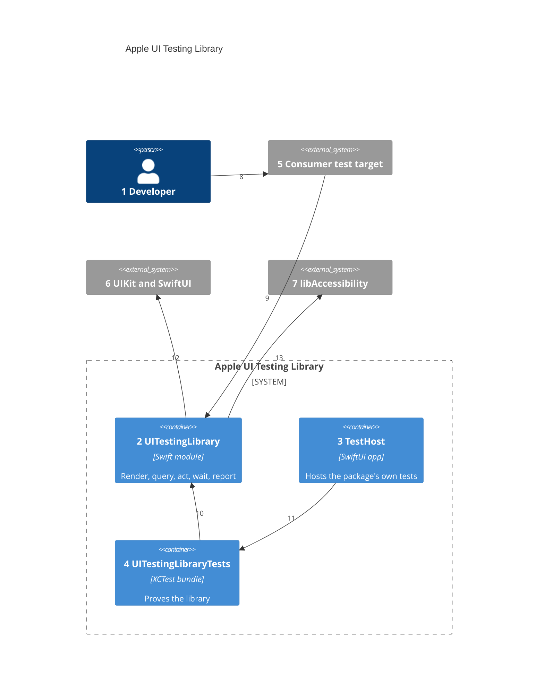

# Containers

Numbers on nodes and arrows match the callout table.

| #   | Description | Why |
| --- | --- | --- |
| 1   | Writes tests in a consumer app or in this repo. | Same actor as [01-system-context.md](01-system-context.md). |
| 2   | `Sources/UITestingLibrary/`, the one library product in `Package.swift`. | One import gives a test everything it needs. |
| 3   | `TestHost/`: a small SwiftUI app with a scene, generated by XcodeGen from `project.yml`. | Hosted tests need a running app with a window scene. |
| 4   | `Tests/UITestingLibraryTests/`, hosted by `TestHost`. | The library is proven against real SwiftUI screens. |
| 5   | A consumer's hosted test bundle, such as May Calendar's `Requirements`. | Consumers add the package through XcodeGen `packages:` with `majorVersion: 1`. |
| 6   | Windows, hosting controllers, and the views under test. | The library draws through public UIKit API. |
| 7   | `/usr/lib/libAccessibility.dylib`, reached with `dlopen`. | Its private `_AXSSetAutomationEnabled` makes SwiftUI build its tree ([ADR 0004](adr/0004-automation-canary.md)). |
| 8   | The developer writes tests in their own target. | Tests live beside the app they prove. |
| 9   | The consumer target imports `UITestingLibrary`. | Test targets only; the app never links it. |
| 10  | This repo's tests import the module. | They use the public API, as a consumer does. |
| 11  | `TestHost` runs `UITestingLibraryTests` in its process. | The same hosting a consumer uses. |
| 12  | The module draws the root in a key `UIWindow` through `UIHostingController`. | The real view hierarchy, in-process ([ADR 0001](adr/0001-in-process-accessibility-tree.md)). |
| 13  | The module turns automation on once per process. | Without it the tree comes back empty. |
