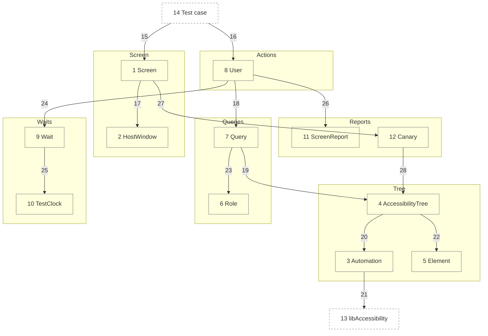

# Components

This decomposes the `UITestingLibrary` container in [02-containers.md](02-containers.md) into its parts. A test renders a screen, then a `User` finds and acts on what VoiceOver reads there.

Numbers match the callout table. Containers: [02-containers.md](02-containers.md). Code: [04-code.md](04-code.md).

| #   | Description | Why |
| --- | --- | --- |
| 1   | `Screen.render(size:traits:content:)` draws a root view and closes it at teardown. | The test's one handle on what is drawn. |
| 2   | Makes a key `UIWindow` on the host's scene, sized to a phone, holding a `UIHostingController`. | A fixed size and size class make layout the same on any Mac or simulator. |
| 3   | Calls `_AXSSetAutomationEnabled(1)` once, through `dlsym`. | SwiftUI builds its tree only while assistive technology asks ([ADR 0004](adr/0004-automation-canary.md)). |
| 4   | Walks the window depth first, as VoiceOver moves. It skips hidden views, and a modal view hides its siblings. | Only what a person can reach counts. |
| 5   | A value read from one element: spoken text, traits, frame, identifier, and actions. | Queries and reports share one reading. |
| 6   | The roles a query names, each mapped to accessibility traits. | `.button` never matches static text that shares its label ([ADR 0002](adr/0002-query-priority.md)). |
| 7   | Matches elements by role and label, by text, or by identifier. | One priority keeps tests on what a person perceives. |
| 8   | Acts as a person does: taps, holds a custom action, scrolls, goes back, types, adjusts. Each act needs an actionable element. | Every act is a VoiceOver entry point, so an unreachable control fails. |
| 9   | Polls a condition until it holds or the deadline passes, then waits for the tree to settle. | No sleeps; a slow machine only takes longer ([ADR 0003](adr/0003-condition-waits.md)). |
| 10  | A `Clock` the app's own waits can run on, moved only by `Wait`. | App timers fire on demand, with no real waiting. |
| 11  | Prints what VoiceOver reads on screen, then what is drawn off screen. | A failure shows the screen as a person hears it. |
| 12  | Fails a test that never read a non-empty tree. | An OS change that empties the tree cannot pass silently. |
| 13  | Apple's accessibility library, holding the private automation switch. | The only way in-process tests get SwiftUI's tree. |
| 14  | A consumer's XCTest or Swift Testing case, on the main actor. | The library is driven from tests only. |
| 15  | The test renders its app root. | One screen per test ([ADR 0005](adr/0005-one-window-per-process.md)). |
| 16  | The test acts and looks through a `User`. | Tests read as a person's steps. |
| 17  | The screen draws into its window. | Window setup stays in one place. |
| 18  | Each act or look resolves a query first. | An act lands on what a person would find. |
| 19  | Queries read the current tree. | The tree is read fresh on each poll. |
| 20  | The first read turns automation on. | Turned on lazily, once per process. |
| 21  | Automation reaches the private symbol. | A missing symbol is reported by the canary. |
| 22  | The walk yields `Element` values. | Matching never touches view types. |
| 23  | A role query checks traits. | Role first, as Testing Library ranks it. |
| 24  | Every act and look waits on a condition. | Animations are off, so the settled tree is final. |
| 25  | A wait moves the test clock each poll. | App time moves only while the test looks. |
| 26  | A failed look or act hands the screen to the report. | One failure format everywhere. |
| 27  | Closing a screen runs the canary. | Every test gets the check for free. |
| 28  | The canary asks whether any read found elements. | It needs no test code. |
