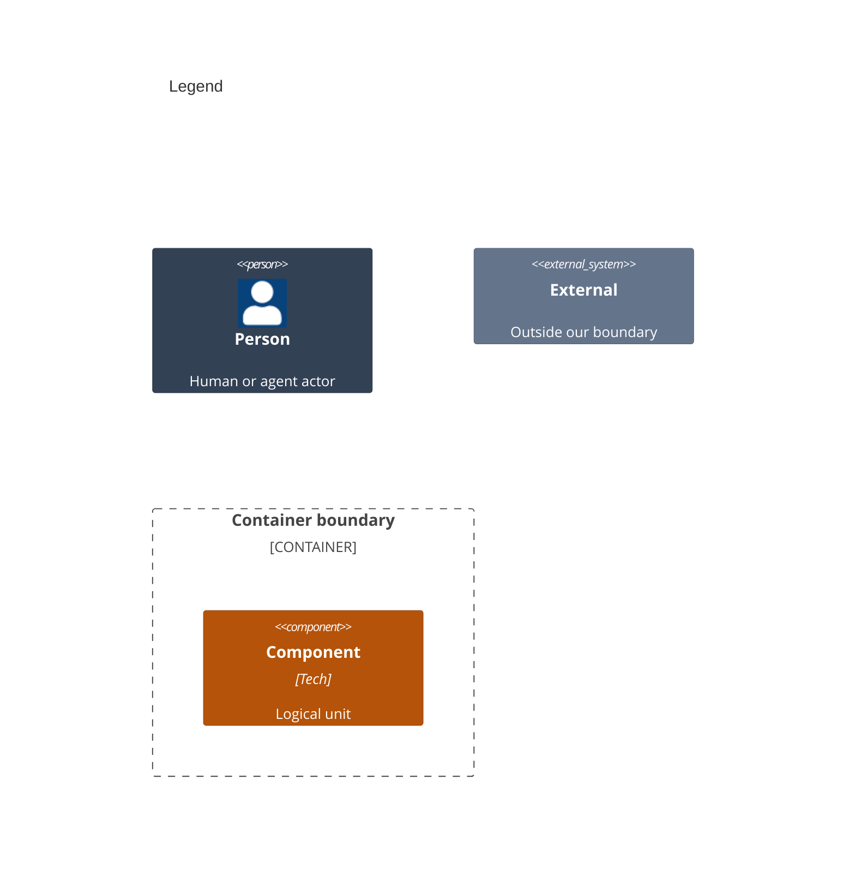

# Components

This decomposes the apps in [02-containers.md](02-containers.md) into the products and fixtures they run. A test renders a screen, then a `User` finds and acts on what VoiceOver reads there. A system test drives the launched app through a `SystemSession` instead.

```mermaid
C4Component
    title Apple UI Testing Library

    System_Ext(test, "19 Hosted test case")
    System_Ext(sysTest, "20 System test case")

    Container_Boundary(lib, "23 UITestingLibrary") {
        Component(scr, "1 Screen", "Swift", "Draws a root view")
        Component(win, "2 HostWindow", "Swift", "Holds the key window")
        Component(auto, "3 Automation", "Swift", "Turns automation on")
        Component(walk, "4 AccessibilityTree", "Swift", "Walks and drives elements")
        Component(elem, "5 Element", "Swift", "One element as VoiceOver reads it")
        Component(role, "6 Role", "Swift", "Roles a query names")
        Component(query, "7 Query", "Swift", "Finds elements")
        Component(user, "8 User", "Swift", "Acts and looks like a person")
        Component(wait, "9 Wait", "Swift", "Polls a condition")
        Component(report, "10 ScreenReport", "Swift", "Prints the screen and failures")
        Component(canary, "11 Canary", "Swift", "Fails a test that read nothing")
    }

    Container_Boundary(sys, "24 UITestingLibrarySystem") {
        Component(session, "12 SystemSession", "Swift", "Drives the launched app")
        Component(siri, "13 Siri", "Swift", "Asks Siri")
        Component(delivery, "14 SharedDelivery", "Swift", "Reads a delivered share")
    }

    Container_Boundary(dest, "25 UITestingLibraryShareDestination") {
        Component(local, "15 LocalShareDestination", "Swift", "Keeps what a share delivers")
    }

    Container_Boundary(hostApp, "26 Host app") {
        Component(app, "16 TestHostApp", "Swift", "Opens the host window")
        Component(fixtures, "17 Fixtures", "Swift", "Screens each test renders")
    }

    Container_Boundary(pkg, "27 Package") {
        Component(manifest, "18 Package manifest", "Swift", "Declares the products")
    }

    System_Ext(ax, "21 libAccessibility")
    System_Ext(systemUI, "22 Siri and the share sheet")

    Rel(test, scr, "A")
    Rel(test, user, "B")
    Rel(scr, win, "C")
    Rel(scr, canary, "D")
    Rel(scr, walk, "E")
    Rel(scr, report, "F")
    Rel(win, scr, "G")
    Rel(win, walk, "H")
    Rel(user, query, "I")
    Rel(user, scr, "J")
    Rel(user, wait, "K")
    Rel(user, walk, "L")
    Rel(user, elem, "M")
    Rel(user, report, "N")
    Rel(query, walk, "O")
    Rel(query, elem, "P")
    Rel(query, role, "Q")
    Rel(walk, auto, "R")
    Rel(auto, walk, "S")
    Rel(auto, ax, "T")
    Rel(walk, elem, "U")
    Rel(walk, scr, "V")
    Rel(walk, win, "W")
    Rel(walk, role, "X")
    Rel(elem, role, "Y")
    Rel(wait, scr, "Z")
    Rel(wait, walk, "AA")
    Rel(report, walk, "BB")
    Rel(report, elem, "CC")
    Rel(canary, scr, "DD")
    Rel(canary, report, "EE")
    Rel(sysTest, session, "FF")
    Rel(siri, session, "GG")
    Rel(delivery, session, "HH")
    Rel(delivery, report, "II")
    Rel(delivery, elem, "JJ")
    Rel(delivery, query, "KK")
    Rel(siri, report, "LL")
    Rel(session, query, "MM")
    Rel(session, report, "NN")
    Rel(session, elem, "OO")
    Rel(session, role, "PP")
    Rel(session, systemUI, "QQ")
    Rel(app, fixtures, "RR")
    Rel(fixtures, local, "SS")
    Rel(systemUI, local, "TT")

    UpdateElementStyle(test, $bgColor="#64748b", $borderColor="#475569", $fontColor="#ffffff")
    UpdateElementStyle(sysTest, $bgColor="#64748b", $borderColor="#475569", $fontColor="#ffffff")
    UpdateElementStyle(ax, $bgColor="#64748b", $borderColor="#475569", $fontColor="#ffffff")
    UpdateElementStyle(systemUI, $bgColor="#64748b", $borderColor="#475569", $fontColor="#ffffff")
    UpdateElementStyle(scr, $bgColor="#b45309", $borderColor="#92400e", $fontColor="#ffffff")
    UpdateElementStyle(win, $bgColor="#b45309", $borderColor="#92400e", $fontColor="#ffffff")
    UpdateElementStyle(auto, $bgColor="#b45309", $borderColor="#92400e", $fontColor="#ffffff")
    UpdateElementStyle(walk, $bgColor="#b45309", $borderColor="#92400e", $fontColor="#ffffff")
    UpdateElementStyle(elem, $bgColor="#b45309", $borderColor="#92400e", $fontColor="#ffffff")
    UpdateElementStyle(role, $bgColor="#b45309", $borderColor="#92400e", $fontColor="#ffffff")
    UpdateElementStyle(query, $bgColor="#b45309", $borderColor="#92400e", $fontColor="#ffffff")
    UpdateElementStyle(user, $bgColor="#b45309", $borderColor="#92400e", $fontColor="#ffffff")
    UpdateElementStyle(wait, $bgColor="#b45309", $borderColor="#92400e", $fontColor="#ffffff")
    UpdateElementStyle(report, $bgColor="#b45309", $borderColor="#92400e", $fontColor="#ffffff")
    UpdateElementStyle(canary, $bgColor="#b45309", $borderColor="#92400e", $fontColor="#ffffff")
    UpdateElementStyle(session, $bgColor="#b45309", $borderColor="#92400e", $fontColor="#ffffff")
    UpdateElementStyle(siri, $bgColor="#b45309", $borderColor="#92400e", $fontColor="#ffffff")
    UpdateElementStyle(delivery, $bgColor="#b45309", $borderColor="#92400e", $fontColor="#ffffff")
    UpdateElementStyle(local, $bgColor="#b45309", $borderColor="#92400e", $fontColor="#ffffff")
    UpdateElementStyle(app, $bgColor="#b45309", $borderColor="#92400e", $fontColor="#ffffff")
    UpdateElementStyle(fixtures, $bgColor="#b45309", $borderColor="#92400e", $fontColor="#ffffff")
    UpdateElementStyle(manifest, $bgColor="#b45309", $borderColor="#92400e", $fontColor="#ffffff")
```

Numbers on nodes and letters on arrows match the callout table. Containers: [02-containers.md](02-containers.md). Code: [04-code.md](04-code.md).

| #   | Description | Why |
| --- | --- | --- |
| 1   | `Screen.render(size:look:content:)` draws a root view at a size, text size and appearance, and closes it at teardown. Built from `Sources/UITestingLibrary/Screen/Screen.swift`, `Sources/UITestingLibrary/Screen/ScreenSize.swift` and `Sources/UITestingLibrary/Screen/Look.swift`. | The test's one handle on what is drawn. |
| 2   | `Sources/UITestingLibrary/Screen/HostWindow.swift` makes a key window at a fixed size, holding the platform's hosting controller. | A fixed size and size class make layout the same on any Mac or simulator ([ADR 0006](adr/0006-one-api-two-backends.md)). |
| 3   | `Sources/UITestingLibrary/Tree/Automation.swift` calls `_AXSSetAutomationEnabled(1)` once, through `dlsym`. | SwiftUI builds its tree only while assistive technology asks ([ADR 0004](adr/0004-automation-canary.md)). |
| 4   | Walks the window depth first, as VoiceOver moves, and drives elements. Built from `Sources/UITestingLibrary/Tree/AccessibilityTree.swift`, `Sources/UITestingLibrary/Tree/Timing.swift`, `Sources/UITestingLibrary/Tree/Trackpad.swift`, and the `Sources/UITestingLibrary/Tree/UIKit*` and `Sources/UITestingLibrary/Tree/AppKit*` backends. | Only what a person can reach counts. Hidden views are skipped, a modal hides its siblings, and an open menu shows only its items. |
| 5   | `Sources/UITestingLibrary/Tree/Element.swift`: spoken text, traits, frame, identifier, actions, and enabled state ([ADR 0007](adr/0007-control-state.md)). | Queries and reports share one reading. |
| 6   | `Sources/UITestingLibrary/Queries/Role.swift`: the roles a query names, each mapped to accessibility traits. | `.button` never matches static text that shares its label ([ADR 0002](adr/0002-query-priority.md)). |
| 7   | `Sources/UITestingLibrary/Queries/Query.swift` and `Sources/UITestingLibrary/Queries/Match.swift` match elements by role and label, by text, or by identifier. | One priority keeps tests on what a person perceives. |
| 8   | `Sources/UITestingLibrary/Actions/` taps, opens menus, chooses custom actions, scrolls, goes back, types, presses keys, tabs, uses the clipboard, and double-taps, holds, swipes, drags onto a target or by a distance, adjusts, hovers and pinches. Each act needs its element or a field being edited. | Every act is a VoiceOver entry point, so an unreachable control fails. |
| 9   | `Sources/UITestingLibrary/Waits/` polls a condition until it holds or the deadline passes, or for a set time, and times main-thread stalls. | No sleeps; a slow machine only takes longer ([ADR 0003](adr/0003-condition-waits.md)). |
| 10  | `Sources/UITestingLibrary/Reports/ScreenReport.swift`, `Sources/UITestingLibrary/Reports/Failure.swift` and `Sources/UITestingLibrary/Reports/SourceLocation.swift` print what is on and off screen. | A failure shows the screen as a person hears it, at the test's own line. |
| 11  | `Sources/UITestingLibrary/Reports/Canary.swift` fails a test that never read a non-empty tree. | An OS change that empties the tree cannot pass silently. |
| 12  | `Sources/UITestingLibrarySystem/Tree/SystemSession.swift` launches the app and finds, taps, scrolls and reads through XCTest automation. | A UI-test target reaches system UI the hosted tree cannot ([ADR 0009](adr/0009-system-sharing.md)). |
| 13  | `Sources/UITestingLibrarySystem/Tree/Siri.swift` submits a phrase and checks the visible transcript. | Siri runs outside the app's process ([ADR 0008](adr/0008-siri-system-requests.md)). |
| 14  | `Sources/UITestingLibrarySystem/Tree/SharedDelivery.swift` follows a share into the local destination and reads the delivered items. | Only received bytes prove what a destination got. |
| 15  | `Sources/UITestingLibraryShareDestination/` adds a local `UIActivity` that exports the images and messages it receives. | No message reaches a contact. |
| 16  | `TestHost/TestHostApp.swift` opens the host's one window and reads a system test's launch argument. | Both apps share one source folder. |
| 17  | `TestHost/Fixtures/` holds the screens each requirement test renders, plus the Siri intent and the sharing screen. | Tests prove behavior against real SwiftUI screens. |
| 18  | `Sources/../Package.swift` declares the three library products. | Consumers import only what their target needs. |
| 19  | A consumer's hosted XCTest or Swift Testing case, on the main actor. | The library is driven from tests only. |
| 20  | A test in a UI-test target, such as `Tests/System/`. | System UI needs a runner outside the app. |
| 21  | Apple's accessibility library, holding the private automation switch. | The only way in-process tests get SwiftUI's tree. |
| 22  | The system's Siri overlay and share sheet. | Shown on a simulator, outside the app's process. |
| 23  | The `UITestingLibrary` product, whose components are the folders under it. | The hosted library every consumer imports. |
| 24  | The optional `UITestingLibrarySystem` product. | It runs in a UI-test target, outside the app's process. |
| 25  | The optional `UITestingLibraryShareDestination` product. | Test builds add its local share destination. |
| 26  | The host app that renders each requirement test's screens. | Both host apps share one source folder. |
| 27  | The package that declares the products. | Consumers import only what their target needs. |
| A   | The test renders its app root. | One screen per test ([ADR 0005](adr/0005-one-window-per-process.md)). |
| B   | The test acts and looks through a `User`. | Tests read as a person's steps. |
| C   | The screen draws into its window. | Window setup stays in one place. |
| D   | Closing a screen runs the canary. | Every test gets the check for free. |
| E   | The screen times its render. | Each phase shows in the timing report. |
| F   | A screen that cannot render throws a `Failure`. | One failure format everywhere. |
| G   | The window takes the screen's size. | One size type for both platforms. |
| H   | Closing the window closes any open menu through the backend. | Only `Screen/` and `Tree/` branch on platform. |
| I   | Each act or look resolves a query first. | An act lands on what a person would find. |
| J   | A `User` acts on the screen it was given. | Each test holds one screen. |
| K   | Every act and look waits on a condition. | Animations are off, so the settled tree is final. |
| L   | Acts drive elements through the backend and time each phase. | The backend knows each platform's entry points. |
| M   | Acts read the found `Element`. | An act checks the element is actionable first. |
| N   | A failed look or act hands the screen to the report. | One failure format everywhere. |
| O   | Queries read the current tree. | A poll reuses the last read only while nothing else has run on the main thread. |
| P   | Matching works on `Element` values. | Matching never touches view types. |
| Q   | A role query checks traits. | Role first, as Testing Library ranks it. |
| R   | The first read turns automation on. | Turned on lazily, once per process. |
| S   | Automation flips the switch through the platform backend. | Each platform reaches the symbol its own way. |
| T   | Automation reaches the private symbol. | A missing symbol is reported by the canary. |
| U   | The walk yields `Element` values; one drawn off screen is read on first use. | No look matches off screen. |
| V   | `AccessibilityTree.read(_:)` takes the open `Screen` and marks that a read found elements. | The canary checks that mark at close. |
| W   | The backends act inside the host window. | Alerts and menus open over that window. |
| X   | The backends map traits to roles. | Each platform names roles its own way. |
| Y   | An element carries its roles. | Roles are read once per element. |
| Z   | A wait reads the screen it settles. | It needs the window to read. |
| AA  | After an act, a wait lets the main run loop go idle twice, then reads once. | A settle costs one read. |
| BB  | The report reads the current tree. | It shows what VoiceOver reads now. |
| CC  | The report prints each `Element`. | On-screen and off-screen elements read apart. |
| DD  | The canary checks the closing screen. | It needs no test code. |
| EE  | A canary failure names the test's line. | It reads like any other failure. |
| FF  | A system test launches the app through a `SystemSession`. | One session per launched app. |
| GG  | Siri requests extend the session. | One session drives the app and the system UI. |
| HH  | Share checks extend the session. | The same deadline and failure rules apply. |
| II  | A delivery check throws the library's `Failure`. | One failure format everywhere. |
| JJ  | A delivery check reads the library's `Element` values. | One reading of an element on both products. |
| KK  | A delivery check finds items with the library's `Query`. | A system test reads like a hosted one. |
| LL  | A Siri check reports at the test's `SourceLocation`. | Every failure names the test's line. |
| MM  | The system session finds elements with the library's `Query`. | A system test reads like a hosted one. |
| NN  | The system session throws the library's `Failure`. | One failure format everywhere. |
| OO  | The system session reads the library's `Element` values. | One reading of an element on both products. |
| PP  | The system session names roles with the library's `Role`. | The same role names on both products. |
| QQ  | The session opens Siri and the share sheet and reads them. | Only a separate process can drive system UI. |
| RR  | With the sharing launch argument, the iOS app shows the sharing screen. | A system test opens its screen without tapping through menus. |
| SS  | The sharing screen adds the local destination to its sheet. | Test builds add it; release builds omit it. |
| TT  | The share sheet hands the shared items to the local destination. | The destination keeps only what the system delivers. |
