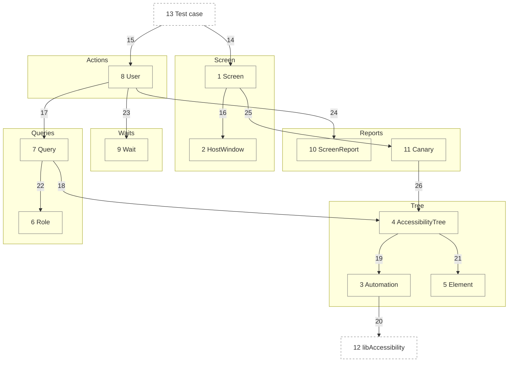

# Components

This decomposes the `UITestingLibrary` container in [02-containers.md](02-containers.md) into its parts. A test renders a screen, then a `User` finds and acts on what VoiceOver reads there.

Numbers match the callout table. Containers: [02-containers.md](02-containers.md). Code: [04-code.md](04-code.md).

| #   | Description | Why |
| --- | --- | --- |
| 1   | `Screen.render(size:look:content:)` draws a root view at a size, text size and appearance, and closes it at teardown. | The test's one handle on what is drawn. |
| 2   | Makes a key window on the host, a `UIWindow` on iOS or an `NSWindow` on macOS, at a fixed size, holding the platform's hosting controller. | A fixed size and size class make layout the same on any Mac or simulator ([ADR 0006](adr/0006-one-api-two-backends.md)). |
| 3   | Calls `_AXSSetAutomationEnabled(1)` once, through `dlsym`. | SwiftUI builds its tree only while assistive technology asks ([ADR 0004](adr/0004-automation-canary.md)). |
| 4   | Walks the window depth first, as VoiceOver moves, through the UIKit or AppKit backend. It skips hidden views, and a modal view hides its siblings. While a menu is open, only its items are read. | Only what a person can reach counts. |
| 5   | A value read from one element: spoken text, traits, frame, identifier, actions, and enabled state ([ADR 0007](adr/0007-control-state.md)). | Queries and reports share one reading. |
| 6   | The roles a query names, each mapped to accessibility traits. | `.button` never matches static text that shares its label ([ADR 0002](adr/0002-query-priority.md)). |
| 7   | Matches elements by role and label, by text, or by identifier. | One priority keeps tests on what a person perceives. |
| 8   | Acts as a person does: taps, including a menu and its items, chooses a custom action, scrolls, goes back, types. Each act needs an actionable element. | Every act is a VoiceOver entry point, so an unreachable control fails. |
| 9   | Polls a condition until it holds or the deadline passes. After an act, it lets the main run loop go idle twice, then reads once. | No sleeps; a slow machine only takes longer ([ADR 0003](adr/0003-condition-waits.md)). |
| 10  | Prints what VoiceOver reads on screen, then what is drawn off screen. | A failure shows the screen as a person hears it. |
| 11  | Fails a test that never read a non-empty tree. | An OS change that empties the tree cannot pass silently. |
| 12  | Apple's accessibility library, holding the private automation switch. | The only way in-process tests get SwiftUI's tree. |
| 13  | A consumer's XCTest or Swift Testing case, on the main actor. | The library is driven from tests only. |
| 14  | The test renders its app root. | One screen per test ([ADR 0005](adr/0005-one-window-per-process.md)). |
| 15  | The test acts and looks through a `User`. | Tests read as a person's steps. |
| 16  | The screen draws into its window. | Window setup stays in one place. |
| 17  | Each act or look resolves a query first. | An act lands on what a person would find. |
| 18  | Queries read the current tree. | A poll reuses the last read only while nothing else has run on the main thread. |
| 19  | The first read turns automation on. | Turned on lazily, once per process. |
| 20  | Automation reaches the private symbol. | A missing symbol is reported by the canary. |
| 21  | The walk yields `Element` values; one drawn off screen is read on first use. | Matching never touches view types, and no look matches off screen. |
| 22  | A role query checks traits. | Role first, as Testing Library ranks it. |
| 23  | Every act and look waits on a condition. | Animations are off, so the settled tree is final. |
| 24  | A failed look or act hands the screen to the report. | One failure format everywhere. |
| 25  | Closing a screen runs the canary. | Every test gets the check for free. |
| 26  | The canary asks whether any read found elements. | It needs no test code. |
