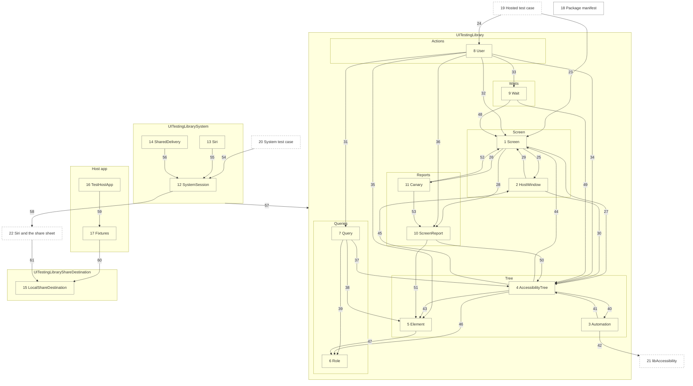
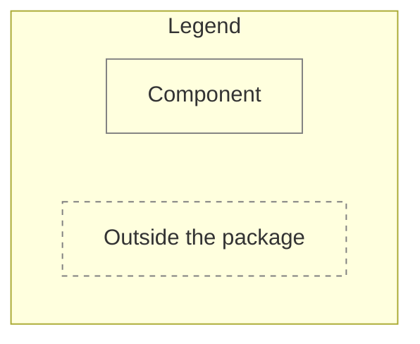

# Components

This decomposes the apps in [02-containers.md](02-containers.md) into the products and fixtures they run. A test renders a screen, then a `User` finds and acts on what VoiceOver reads there. A system test drives the launched app through a `SystemSession` instead.

Numbers match the callout table. Containers: [02-containers.md](02-containers.md). Code: [04-code.md](04-code.md).

| #   | Description | Why |
| --- | --- | --- |
| 1   | `Screen.render(size:look:content:)` draws a root view at a size, text size and appearance, and closes it at teardown. Built from `Sources/UITestingLibrary/Screen/Screen.swift`, `Sources/UITestingLibrary/Screen/ScreenSize.swift` and `Sources/UITestingLibrary/Screen/Look.swift`. | The test's one handle on what is drawn. |
| 2   | `Sources/UITestingLibrary/Screen/HostWindow.swift` makes a key window at a fixed size, holding the platform's hosting controller. | A fixed size and size class make layout the same on any Mac or simulator ([ADR 0006](adr/0006-one-api-two-backends.md)). |
| 3   | `Sources/UITestingLibrary/Tree/Automation.swift` calls `_AXSSetAutomationEnabled(1)` once, through `dlsym`. | SwiftUI builds its tree only while assistive technology asks ([ADR 0004](adr/0004-automation-canary.md)). |
| 4   | Walks the window depth first, as VoiceOver moves, and drives elements. Built from `Sources/UITestingLibrary/Tree/AccessibilityTree.swift`, `Sources/UITestingLibrary/Tree/Timing.swift`, `Sources/UITestingLibrary/Tree/Trackpad.swift`, and the `Sources/UITestingLibrary/Tree/UIKit*` and `Sources/UITestingLibrary/Tree/AppKit*` backends. | Only what a person can reach counts. Hidden views are skipped, a modal hides its siblings, and an open menu shows only its items. |
| 5   | `Sources/UITestingLibrary/Tree/Element.swift`: spoken text, traits, frame, identifier, actions, and enabled state ([ADR 0007](adr/0007-control-state.md)). | Queries and reports share one reading. |
| 6   | `Sources/UITestingLibrary/Queries/Role.swift`: the roles a query names, each mapped to accessibility traits. | `.button` never matches static text that shares its label ([ADR 0002](adr/0002-query-priority.md)). |
| 7   | `Sources/UITestingLibrary/Queries/Query.swift` and `Sources/UITestingLibrary/Queries/Match.swift` match elements by role and label, by text, or by identifier. | One priority keeps tests on what a person perceives. |
| 8   | `Sources/UITestingLibrary/Actions/` taps, opens menus, chooses custom actions, scrolls, goes back, types, presses keys, tabs, uses the clipboard, and double-taps, holds, swipes, drags onto a target or by a distance, adjusts, hovers and pinches. Each act needs its element or a field being edited. | Every act is a VoiceOver entry point, so an unreachable control fails. |
| 9   | `Sources/UITestingLibrary/Waits/` polls a condition until it holds or the deadline passes, or for a set time, and times main-thread stalls. | No sleeps; a slow machine only takes longer ([ADR 0003](adr/0003-condition-waits.md)). |
| 10  | `Sources/UITestingLibrary/Reports/ScreenReport.swift`, `Sources/UITestingLibrary/Reports/Failure.swift` and `Sources/UITestingLibrary/Reports/SourceLocation.swift` print what is on and off screen. | A failure shows the screen as a person hears it, at the test's own line. |
| 11  | `Sources/UITestingLibrary/Reports/Canary.swift` fails a test that never read a non-empty tree. | An OS change that empties the tree cannot pass silently. |
| 12  | `Sources/UITestingLibrarySystem/Tree/SystemSession.swift` launches the app and finds, taps, scrolls and reads through XCTest automation. | A UI-test target reaches system UI the hosted tree cannot ([ADR 0009](adr/0009-system-sharing.md)). |
| 13  | `Sources/UITestingLibrarySystem/Tree/Siri.swift` submits a phrase and checks the visible transcript. | Siri runs outside the app's process ([ADR 0008](adr/0008-siri-system-requests.md)). |
| 14  | `Sources/UITestingLibrarySystem/Tree/SharedDelivery.swift` follows a share into the local destination and reads the delivered items. | Only received bytes prove what a destination got. |
| 15  | `Sources/UITestingLibraryShareDestination/` adds a local `UIActivity` that exports the images and messages it receives. | No message reaches a contact. |
| 16  | `TestHost/TestHostApp.swift` opens the host's one window and reads a system test's launch argument. | Both apps share one source folder. |
| 17  | `TestHost/Fixtures/` holds the screens each requirement test renders, plus the Siri intent and the sharing screen. | Tests prove behavior against real SwiftUI screens. |
| 18  | `Sources/../Package.swift` declares the three library products. | Consumers import only what their target needs. |
| 19  | A consumer's hosted XCTest or Swift Testing case, on the main actor. | The library is driven from tests only. |
| 20  | A test in a UI-test target, such as `Tests/System/`. | System UI needs a runner outside the app. |
| 21  | Apple's accessibility library, holding the private automation switch. | The only way in-process tests get SwiftUI's tree. |
| 22  | The system's Siri overlay and share sheet. | Shown on a simulator, outside the app's process. |
| 23  | The test renders its app root. | One screen per test ([ADR 0005](adr/0005-one-window-per-process.md)). |
| 24  | The test acts and looks through a `User`. | Tests read as a person's steps. |
| 25  | The screen draws into its window. | Window setup stays in one place. |
| 26  | Closing a screen runs the canary. | Every test gets the check for free. |
| 27  | The screen times its render. | Each phase shows in the timing report. |
| 28  | A screen that cannot render throws a `Failure`. | One failure format everywhere. |
| 29  | The window takes the screen's size. | One size type for both platforms. |
| 30  | Closing the window closes any open menu through the backend. | Only `Screen/` and `Tree/` branch on platform. |
| 31  | Each act or look resolves a query first. | An act lands on what a person would find. |
| 32  | A `User` acts on the screen it was given. | Each test holds one screen. |
| 33  | Every act and look waits on a condition. | Animations are off, so the settled tree is final. |
| 34  | Acts drive elements through the backend and time each phase. | The backend knows each platform's entry points. |
| 35  | Acts read the found `Element`. | An act checks the element is actionable first. |
| 36  | A failed look or act hands the screen to the report. | One failure format everywhere. |
| 37  | Queries read the current tree. | A poll reuses the last read only while nothing else has run on the main thread. |
| 38  | Matching works on `Element` values. | Matching never touches view types. |
| 39  | A role query checks traits. | Role first, as Testing Library ranks it. |
| 40  | The first read turns automation on. | Turned on lazily, once per process. |
| 41  | Automation flips the switch through the platform backend. | Each platform reaches the symbol its own way. |
| 42  | Automation reaches the private symbol. | A missing symbol is reported by the canary. |
| 43  | The walk yields `Element` values; one drawn off screen is read on first use. | No look matches off screen. |
| 44  | `AccessibilityTree.read(_:)` takes the open `Screen` and marks that a read found elements. | The canary checks that mark at close. |
| 45  | The backends act inside the host window. | Alerts and menus open over that window. |
| 46  | The backends map traits to roles. | Each platform names roles its own way. |
| 47  | An element carries its roles. | Roles are read once per element. |
| 48  | A wait reads the screen it settles. | It needs the window to read. |
| 49  | After an act, a wait lets the main run loop go idle twice, then reads once. | A settle costs one read. |
| 50  | The report reads the current tree. | It shows what VoiceOver reads now. |
| 51  | The report prints each `Element`. | On-screen and off-screen elements read apart. |
| 52  | The canary checks the closing screen. | It needs no test code. |
| 53  | A canary failure names the test's line. | It reads like any other failure. |
| 54  | A system test launches the app through a `SystemSession`. | One session per launched app. |
| 55  | Siri requests extend the session. | One session drives the app and the system UI. |
| 56  | Share checks extend the session. | The same deadline and failure rules apply. |
| 57  | The system product uses the library's `Query`, `Role`, `Element` and `Failure` types. | A system test reads like a hosted one. |
| 58  | The session opens Siri and the share sheet and reads them. | Only a separate process can drive system UI. |
| 59  | With the sharing launch argument, the iOS app shows the sharing screen. | A system test opens its screen without tapping through menus. |
| 60  | The sharing screen adds the local destination to its sheet. | Test builds add it; release builds omit it. |
| 61  | The share sheet hands the shared items to the local destination. | The destination keeps only what the system delivers. |
