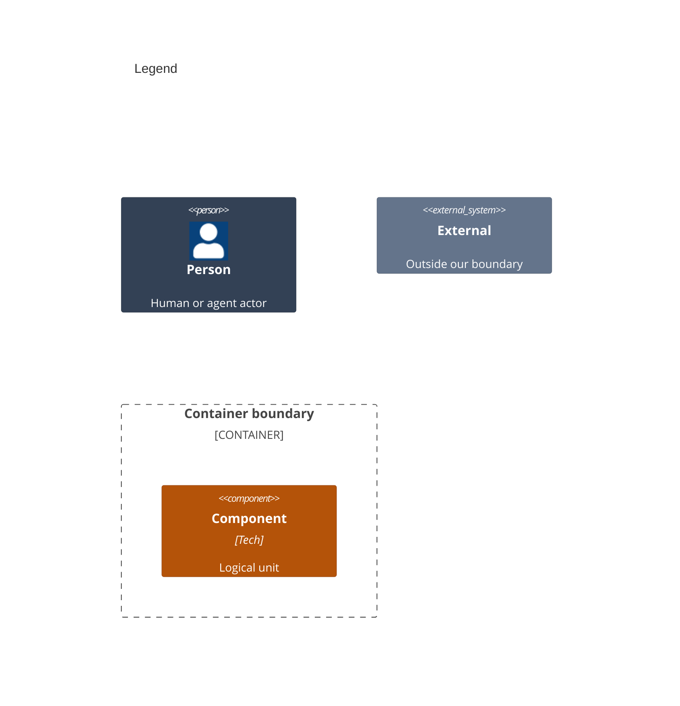

# Components

This decomposes the apps in [02-containers.md](02-containers.md) into the products and fixtures they run. A test renders a screen, then a `User` finds and acts on what VoiceOver reads there. A system test drives the launched app through a `SystemSession` instead.

```mermaid
C4Component
    title Apple UI Testing Library

    Person(dev, "1 Developer")
    System_Ext(test, "2 Hosted test case")
    System_Ext(sysTest, "3 System test case")
    System_Ext(ax, "21 libAccessibility")
    System_Ext(systemUI, "22 Siri and the share sheet")

    Container_Boundary(lib, "4 UITestingLibrary") {
        Container_Boundary(api, "5 What a test calls") {
            Component(user, "6 User", "Swift", "Sources/UITestingLibrary/Actions")
            Container_Boundary(apiBelow, "7 What the user calls") {
                Component(wait, "8 Wait", "Swift", "Sources/UITestingLibrary/Waits")
                Component(scr, "9 Screen", "Swift", "Sources/UITestingLibrary/Screen")
            }
        }
        Container_Boundary(core, "10 Beneath the calls") {
            Component(tree, "11 Tree and queries", "Swift", "Sources/UITestingLibrary/Tree Sources/UITestingLibrary/Queries")
            Component(reports, "12 Reports", "Swift", "Sources/UITestingLibrary/Reports")
        }
    }

    Container_Boundary(sys, "13 UITestingLibrarySystem") {
        Component(system, "14 System session", "Swift", "Sources/UITestingLibrarySystem")
    }

    Container_Boundary(dest, "15 UITestingLibraryShareDestination") {
        Component(local, "16 Local share destination", "Swift", "Sources/UITestingLibraryShareDestination")
    }

    Container_Boundary(pkg, "17 Package") {
        Component(manifest, "18 Package manifest", "Swift", "Package.swift")
    }

    Container_Boundary(hostApp, "19 Host app") {
        Component(hostSources, "20 Host app and fixtures", "Swift", "TestHost/")
    }

    Rel(dev, test, "A")
    Rel(dev, sysTest, "B")
    Rel(test, api, "C")
    Rel(sysTest, system, "D")
    Rel(user, apiBelow, "E")
    Rel(wait, scr, "F")
    Rel(api, core, "G")
    Rel(core, scr, "H")
    Rel(reports, tree, "I")
    Rel(tree, ax, "J")
    Rel(system, core, "K")
    Rel(system, systemUI, "L")
    Rel(systemUI, local, "M")
    Rel(hostSources, local, "N")

    UpdateElementStyle(dev, $bgColor="#334155", $borderColor="#1e293b", $fontColor="#ffffff")
    UpdateElementStyle(test, $bgColor="#64748b", $borderColor="#475569", $fontColor="#ffffff")
    UpdateElementStyle(sysTest, $bgColor="#64748b", $borderColor="#475569", $fontColor="#ffffff")
    UpdateElementStyle(ax, $bgColor="#64748b", $borderColor="#475569", $fontColor="#ffffff")
    UpdateElementStyle(systemUI, $bgColor="#64748b", $borderColor="#475569", $fontColor="#ffffff")
    UpdateElementStyle(user, $bgColor="#b45309", $borderColor="#92400e", $fontColor="#ffffff")
    UpdateElementStyle(wait, $bgColor="#b45309", $borderColor="#92400e", $fontColor="#ffffff")
    UpdateElementStyle(scr, $bgColor="#b45309", $borderColor="#92400e", $fontColor="#ffffff")
    UpdateElementStyle(tree, $bgColor="#b45309", $borderColor="#92400e", $fontColor="#ffffff")
    UpdateElementStyle(reports, $bgColor="#b45309", $borderColor="#92400e", $fontColor="#ffffff")
    UpdateElementStyle(system, $bgColor="#b45309", $borderColor="#92400e", $fontColor="#ffffff")
    UpdateElementStyle(local, $bgColor="#b45309", $borderColor="#92400e", $fontColor="#ffffff")
    UpdateElementStyle(manifest, $bgColor="#b45309", $borderColor="#92400e", $fontColor="#ffffff")
    UpdateElementStyle(hostSources, $bgColor="#b45309", $borderColor="#92400e", $fontColor="#ffffff")
    UpdateLayoutConfig($c4ShapeInRow=" 3", $c4BoundaryInRow=" 3")
```



Numbers on nodes and letters on arrows match the callout table; the code is in [04-code.md](04-code.md). Each arrow is a type one side names in the other's folder, or a hand-off at run time. An arrow to a boundary reaches every part inside it.

| #   | Description | Why |
| --- | --- | --- |
| 1   | Composes the app root and writes tests that read like a person using it. | Testing Library's second user; the person on screen is the first. |
| 2   | A consumer's hosted XCTest or Swift Testing case, on the main actor. | The library is driven from tests only. |
| 3   | A test in a UI-test target, such as the system tests in this repo. | System UI needs a runner outside the app. |
| 4   | The `UITestingLibrary` product, whose components are the folders under it. | The hosted library every consumer imports. |
| 5   | The three types a test names: the user, the wait, and the screen. | A test reads as a person's steps. |
| 6   | The actions folder: `User` taps, opens menus, chooses custom actions, scrolls, goes back, types, presses keys, uses the clipboard, and drags, holds, swipes, adjusts, hovers and pinches. | Every act is a VoiceOver entry point, so an unreachable control fails. |
| 7   | The wait and the screen, which a user also calls. | A user waits for what it looks for on the screen it was given. |
| 8   | The waits folder polls a condition until it holds or the deadline passes, or for a set time, and times main-thread stalls. | No sleeps; a slow machine only takes longer ([ADR 0003](https://github.com/may-journal/apple-ui-testing-library/issues/124)). |
| 9   | The screen folder: `Screen.render(size:look:content:)` draws a root view in a key window at a fixed size, text size and appearance, and closes it at teardown. | A fixed size and size class make layout the same on any Mac or simulator ([ADR 0006](https://github.com/may-journal/apple-ui-testing-library/issues/127)). |
| 10  | What the calls stand on: reading the tree and reporting it. | A test never names these directly. |
| 11  | The tree and queries folders: automation on, a depth-first walk as VoiceOver moves, each element, its role, and queries by role and label, text, or identifier. | Only what a person can reach counts, and one priority keeps tests on what a person perceives ([ADR 0002](https://github.com/may-journal/apple-ui-testing-library/issues/123), [ADR 0007](https://github.com/may-journal/apple-ui-testing-library/issues/128)). |
| 12  | The reports folder prints what is on and off screen, places failures at the test's line, and fails a test that never read a non-empty tree. | An OS change that empties the tree cannot pass silently ([ADR 0004](https://github.com/may-journal/apple-ui-testing-library/issues/125)). |
| 13  | The optional `UITestingLibrarySystem` product. | It runs in a UI-test target, outside the app's process. |
| 14  | `SystemSession` launches the app and finds, taps, scrolls and reads through XCTest automation; `Siri` and `SharedDelivery` build on it. | A UI-test target reaches system UI the hosted tree cannot ([ADR 0008](https://github.com/may-journal/apple-ui-testing-library/issues/129), [ADR 0009](https://github.com/may-journal/apple-ui-testing-library/issues/130)). |
| 15  | The optional `UITestingLibraryShareDestination` product. | Test builds add its local share destination. |
| 16  | A local `UIActivity` that exports the images and messages it receives. | No message reaches a contact. |
| 17  | The package that declares the products. | Consumers import only what their target needs. |
| 18  | `Package.swift`, the manifest that declares the three library products. | It names targets, not types, so no arrow leaves it. |
| 19  | The host app that renders each requirement test's screens. | Both host apps share one source folder. |
| 20  | The host app's window and the fixture screens each requirement test renders, plus the Siri intent and the sharing screen. | Tests prove behavior against real SwiftUI screens. |
| 21  | Apple's accessibility library, holding the private automation switch. | The only way in-process tests get SwiftUI's tree. |
| 22  | The system's Siri overlay and share sheet. | Shown on a simulator, outside the app's process. |
| A   | Writes the hosted test case. | The developer's tests drive the library from the hosted target. |
| B   | Writes the system test case. | System UI needs a UI-test target the developer owns. |
| C   | The test renders its app root, then acts, looks and waits. | One screen per test ([ADR 0005](https://github.com/may-journal/apple-ui-testing-library/issues/126)). |
| D   | A system test opens a session on the launched app. | System tests see what a person sees. |
| E   | A user waits on conditions and reads its screen. | Every act happens on one rendered screen. |
| F   | A wait polls the screen, as [Wait](../../Sources/UITestingLibrary/Waits/Wait.swift#L42) does. | A wait reads the same tree the user acts on. |
| G   | The calls walk the tree, run queries, and print reports. | The tree is the one source of what a person perceives. |
| H   | The tree reads the screen's window, and the canary fails the screen that read nothing. | These are the back references worth cutting. |
| I   | Reports print the tree, as [ScreenReport](../../Sources/UITestingLibrary/Reports/ScreenReport.swift#L25) does. | A failure shows the screen as a person hears it. |
| J   | Automation opens the library and flips its switch. | SwiftUI builds its tree only while assistive technology asks. |
| K   | The system session reuses elements, roles, queries and reports. | System and hosted tests read and fail alike. |
| L   | The system session asks Siri and opens the share sheet. | Siri and sharing run outside the app's process. |
| M   | The share sheet hands the shared items to the local destination. | The destination keeps only what the system delivers. |
| N   | The sharing screen offers the local destination, as [SharingScreen](../../TestHost/Fixtures/SharingScreen.swift#L56) does. | Only received bytes prove what a destination got. |
