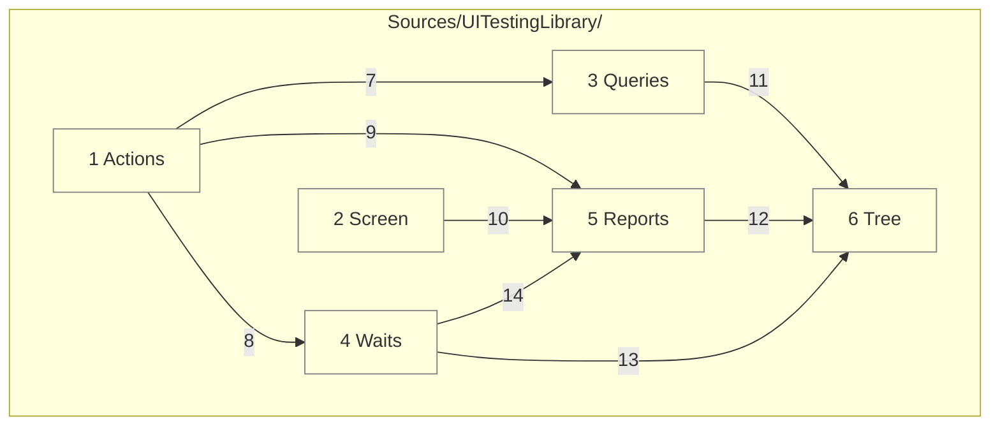

# Code

This grounds the components in [03-components.md](03-components.md) in planned files. All library Swift lives under `Sources/UITestingLibrary/`.

## Layer dependencies

Each folder depends only on the ones below it. Everything runs on the main actor, as UIKit and the tree require.



Numbers match the callout table. See [02-containers.md](02-containers.md) and [03-components.md](03-components.md).

| #   | Description | Why |
| --- | --- | --- |
| 1   | `Actions/`: `User.swift`, `UserActs.swift`, `UserSees.swift`. | The public verbs a test reads in. |
| 2   | `Screen/`: `Screen.swift`, `HostWindow.swift`. | Drawing stays apart from reading. |
| 3   | `Queries/`: `Role.swift`, `Query.swift`, `Match.swift`. | Matching rules live in one place. |
| 4   | `Waits/`: `Wait.swift`. | Every wait shares one deadline rule. |
| 5   | `Reports/`: `ScreenReport.swift`, `Canary.swift`. | Failures read the same everywhere. |
| 6   | `Tree/`: `Automation.swift`, `AccessibilityTree.swift`, `Element.swift`. | The only code that touches accessibility objects. |
| 7   | Actions resolve queries. | An act needs a found element. |
| 8   | Actions wait after each act. | The next look sees a settled screen. |
| 9   | Actions report failures. | One failure format. |
| 10  | `Screen.close()` calls `Canary.check(_:)`. | No test can skip the check. |
| 11  | Queries read the tree. | Matching works on `Element` values. |
| 12  | Reports read the tree. | A report shows what VoiceOver reads now. |
| 13  | Waits read the tree to see it settle. | Two matching reads end a settle. |
| 14  | A timed-out wait hands the screen to the report. | A timeout shows what was on screen. |

## States

| Concern | States |
| ------- | ------ |
| `Automation` | not tried; on; symbol missing. A missing symbol leaves the tree empty, and the canary fails. |
| `Match` | one found; none found; many found. `get` fails on none or many, `query` returns nil on none, and `find` waits for one. |
| `Wait` | held; timed out. A timeout fails with the `ScreenReport`. |
| `Role` | button, link, heading, image, text, text field, search field, adjustable, tab, toggle, selected. |
| Act outcome | done; nothing to act on; not actionable; did nothing. Each failure names the query and prints the report. |
| `Canary` | read elements; read nothing. Reading nothing fails the test at teardown. |

## Platforms

One Swift package, iOS 26 and later, Swift 6 with complete strict concurrency, built with Xcode 27.

| Platform | How it runs |
| -------- | ----------- |
| iPhone simulator | Hosted tests in the simulator's app process. |
| Mac (Designed for iPad) | Hosted tests run natively on Apple silicon, with no simulator boot. |

## Repo tree (outline)

```
apple-ui-testing-library/
├── Package.swift           # library product UITestingLibrary
├── project.yml             # XcodeGen: TestHost app and its hosted tests
├── Sources/
│   └── UITestingLibrary/
│       ├── Actions/        # User, UserActs, UserSees
│       ├── Screen/         # Screen, HostWindow
│       ├── Queries/        # Role, Query, Match
│       ├── Waits/          # Wait
│       ├── Reports/        # ScreenReport, Canary
│       └── Tree/           # Automation, AccessibilityTree, Element
├── TestHost/               # TestHostApp.swift and fixture screens
├── Tests/
│   └── UITestingLibraryTests/
├── docs/
│   ├── architecture/
│   └── requirements/
├── Makefile
├── CHANGELOG.md
└── README.md
```

## Tests

| Concern | Rule |
| ------- | ---- |
| Proof | Each requirement in `docs/requirements/` is proven by one test against a real `TestHost` screen. |
| Run | Serialized, one at a time, each under a time limit. |
| Never | Tests never read view types, view models, or private state. |
