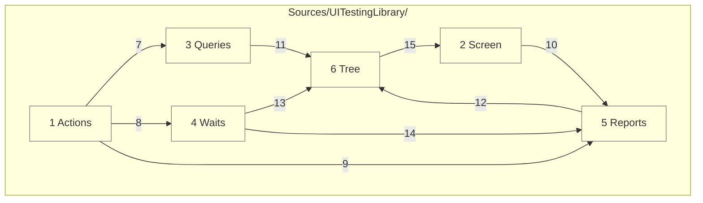

# Code

This grounds the components in [03-components.md](03-components.md) in source files. Hosted library Swift lives under `Sources/UITestingLibrary/`; optional products have their own folders under `Sources/`.

## Layer dependencies

Each folder depends only on the ones below it. Everything runs on the main actor, as UIKit, AppKit and the tree require.



Numbers match the callout table. See [02-containers.md](02-containers.md) and [03-components.md](03-components.md).

| #   | Description | Why |
| --- | --- | --- |
| 1   | `Actions/`: `User.swift`, `UserActs.swift`, `UserKeys.swift`, `UserGestures.swift`, `UserSees.swift`. | The public verbs a test reads in. |
| 2   | `Screen/`: `Screen.swift`, `ScreenSize.swift`, `Look.swift`, `HostWindow.swift`. | Drawing stays apart from reading; `HostWindow` holds the platform branch ([ADR 0006](adr/0006-one-api-two-backends.md)). It keeps a Mac's window off every display ([ADR 0011](adr/0011-person-actions-in-process.md)). |
| 3   | `Queries/`: `Role.swift`, `Query.swift`, `Match.swift`. | Matching rules live in one place. |
| 4   | `Waits/`: `Wait.swift`, `Stalls.swift`. | Every wait shares one deadline rule; stalls are timed on the main run loop ([ADR 0010](adr/0010-keys-watches-share-sheet.md)). |
| 5   | `Reports/`: `ScreenReport.swift`, `Failure.swift`, `SourceLocation.swift`, `Canary.swift`. | Failures read the same everywhere, and name the test's line. |
| 6   | `Tree/`: `Automation.swift`, `AccessibilityTree.swift`, `Element.swift`, `Timing.swift`, then `UIKitTree`, `UIKitActs`, `UIKitMenus`, `UIKitKeys`, `UIKitPointer`, `AppKitTree`, `AppKitActs`, `AppKitMenus`, `AppKitKeys`, `AppKitPointer`. | The only code that touches accessibility objects, one backend per platform. `Timing` signposts each phase, since a read is the lowest one. |
| 7   | Actions resolve queries. | An act needs a found element. |
| 8   | Actions wait after each act. | The next look sees a settled screen. |
| 9   | Actions report failures. | One failure format. |
| 10  | `Screen.close()` calls `Canary.check(_:)`. | No test can skip the check. |
| 11  | Queries read the tree. | Matching works on `Element` values. |
| 12  | Reports read the tree. | A report shows what VoiceOver reads now. |
| 13  | Waits read the tree once it settles. | The main run loop goes idle twice, then one read ends a settle. |
| 14  | A timed-out wait hands the screen to the report. | A timeout shows what was on screen. |
| 15  | The tree reads the screen's window and feeds its canary. | One window, read through one `HostWindow`. |

## States

| Concern | States |
| ------- | ------ |
| `Automation` | not tried; on; symbol missing. A missing symbol leaves the tree empty, and the canary fails. |
| `Match` | one found; none found; many found. `sees` waits for one and fails on none or many; `doesNotSee` waits for none. |
| `Wait` | held; timed out. A timeout fails with the `ScreenReport`. |
| `Role` | button, link, heading, image, text, text field, search field, adjustable, toggle, selected. |
| Act outcome | done; nothing to act on; not actionable; did nothing. Each failure names the query and prints the report. |
| Key | enter; end; home; escape; tab; delete; arrows; each with modifiers. A shortcut answers first. Each key needs a field being edited, and fails "No field is being edited" at the deadline. `clears` and `selectsAll` find their field and edit it first. |
| Clipboard | kept; put back. The first copy, cut or paste keeps what the clipboard holds. Closing the screen puts it back. |
| Gesture | done; no menu; no drag; refused; unchanged; no pointer. Each failure names the query. A swipe on a Mac's list fails, saying it needs a trackpad. |
| Window | off every display; on a display, see-through. The iOS app's scene window comes onto a display, see-through, only for a hover. |
| Watch | held for its set time; failed at the first miss. `neverSees` fails on the first match, or a screen that only read empty. `staysResponsive` fails on a stall at or over its limit. |
| Share sheet | up; not up. `seesShareSheet` waits for the sheet's controller over the window and never reads its contents. |
| `Canary` | read elements; read nothing. Reading nothing fails `close()`, and a `doesNotSee` that only read empty. |
| Menu | closed; open. While a menu is open, a read holds only its items. Tapping an item runs it and closes the menu, and so does `close()`. `goesBack()` closes it without running an item, and each act settles after the Mac finishes closing it. |
| `Failure` | message; report; location. Thrown from every look and act, so the test fails at its own line. |

## Platforms

The optional `UITestingLibrarySystem` product runs in an iOS UI-test target through XCTest. `SystemSession` uses the same `Query` and `Failure` types. Siri failures distinguish setup, indeterminate text, and forbidden text in a verified answer ([ADR 0008](adr/0008-siri-system-requests.md)).

The separate UIKit product `UITestingLibraryShareDestination` adds a local activity in test builds. It exports delivered images and messages, which the driver reads and checks with Vision ([ADR 0009](adr/0009-system-sharing.md)).

One Swift package, iOS 26 and macOS 26 and later, Swift 6 with complete strict concurrency, built with Xcode 27.

| Platform | How it runs |
| -------- | ----------- |
| iOS, Designed for iPad | Hosted tests in the iOS app's process, running natively on this Mac through the UIKit backend, with no simulator boot. The Mac draws an alert natively and hides UIKit's copy, so the backend reads that copy and presses its buttons through the alert. It draws a control's menu natively too: the backend reads the items from UIKit's visible menu once, then closes the Mac's menu by name. A navigation bar's menu button answers no activation, so the backend runs its primary action, which opens the menu. A text size reaches the root, so a layout that reads it changes, but the Mac draws text at one size whatever the setting. The scene's Mac window moves off every display and takes pointer events made in process. |
| Mac | Hosted tests in a Mac app's process, through the AppKit backend, with no simulator boot. A pressed menu control's menu tracks in its own run loop mode, so the backend reads it from the tracking menu. A navigation stack's items live in the window's toolbar, which the backend reads before the content. The window keeps the test's size, so no toolbar item hides in an overflow menu. A text size reaches the root as an environment value; text draws at one size here too. The window sits off every display and counts as key, so the app never comes forward. |

## Repo tree (outline)

```
apple-ui-testing-library/
├── Package.swift           # products UITestingLibrary, UITestingLibrarySystem, UITestingLibraryShareDestination
├── project.yml             # XcodeGen: TestHost and TestHostMac with hosted bundles, plus the system UI-test target
├── Sources/
│   ├── UITestingLibrary/
│   │   ├── Actions/        # User, UserActs, UserSees
│   │   ├── Screen/         # Screen, Look, HostWindow
│   │   ├── Queries/        # Role, Query, Match
│   │   ├── Waits/          # Wait
│   │   ├── Reports/        # ScreenReport, Canary
│   │   └── Tree/           # Automation, AccessibilityTree, Element, UIKit and AppKit backends
│   ├── UITestingLibrarySystem/            # SystemSession, Siri, SharedDelivery
│   └── UITestingLibraryShareDestination/  # LocalShareDestination
├── TestHost/               # TestHostApp.swift and Fixtures/, shared by both hosts
├── Tests/
│   ├── Shared/                    # both bundles: one test per platform-neutral acceptance
│   ├── UITestingLibraryTests/     # the iOS bundle only: the phone and iPad layouts
│   ├── UITestingLibraryMacTests/  # the macOS bundle only: the Mac layout
│   └── System/                    # the opt-in system UI-test target, scheme SystemTests
├── docs/
│   ├── architecture/
│   └── requirements/
├── scripts/                # requirements-coverage.sh and requirements-timing.sh
├── config/                 # timing-phases.json
├── Makefile
├── CHANGELOG.md
└── README.md
```

## Tests

| Concern | Rule |
| ------- | ---- |
| Proof | Each acceptance in `docs/requirements/` is proven by one test named for it, against a real fixture screen in `TestHost`. |
| Run | `make requirements` builds both bundles, then runs them serialized, one test at a time, each under a time limit. Each platform runs `build-for-testing` and then `test-without-building`, so a build failure reads apart from a test failure, and no diagnostics are collected. All output goes to `.build/DerivedData` inside the checkout, so parallel checkouts never share build state. The iOS bundle runs natively on this Mac as Designed for iPad and never boots a simulator. 0001.1 keeps its phone layout, since the host controller sets a compact size class. |
| Coverage | `make requirements-coverage` runs both bundles with coverage on, then `scripts/requirements-coverage.sh` prints line coverage of `Sources/UITestingLibrary/` per platform and combined. Xcode leaves the package's static code out of `.xcresult` coverage, so the script reads each run's `Coverage.profdata` with `llvm-cov` against the test bundle that links the package, leaving out fixtures and tests. It keeps the per-line hits as `.lcov` files in `.build/coverage`. |
| Timing | `make requirements-timing` runs both bundles, then `scripts/requirements-timing.sh` reads the library's signposts from the unified log since the run began. It prints one row per host and phase with the count, total and mean in milliseconds, even after a failing test. Phases nest: an act holds its settle, and a settle holds its reads. The log drops a Designed for iPad run's signpost names, so the phase comes from the code in each interval's ID. `config/timing-phases.json` maps each code to its name and mirrors `Tree/Timing.swift`. |
| Never | Tests never read view types, view models, or private state. |
| Flip | Before a test lands, its Given is flipped once, and the failure must name the Then. |
