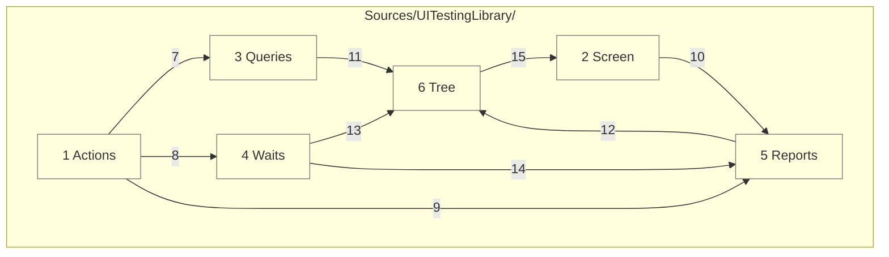

# Code

This grounds the components in [03-components.md](03-components.md) in planned files. All library Swift lives under `Sources/UITestingLibrary/`.

## Layer dependencies

Each folder depends only on the ones below it. Everything runs on the main actor, as UIKit, AppKit and the tree require.



Numbers match the callout table. See [02-containers.md](02-containers.md) and [03-components.md](03-components.md).

| #   | Description | Why |
| --- | --- | --- |
| 1   | `Actions/`: `User.swift`, `UserActs.swift`, `UserSees.swift`. | The public verbs a test reads in. |
| 2   | `Screen/`: `Screen.swift`, `ScreenSize.swift`, `HostWindow.swift`. | Drawing stays apart from reading; `HostWindow` holds the platform branch ([ADR 0006](adr/0006-one-api-two-backends.md)). |
| 3   | `Queries/`: `Role.swift`, `Query.swift`, `Match.swift`. | Matching rules live in one place. |
| 4   | `Waits/`: `Wait.swift`. | Every wait shares one deadline rule. |
| 5   | `Reports/`: `ScreenReport.swift`, `Failure.swift`, `SourceLocation.swift`, `Canary.swift`. | Failures read the same everywhere, and name the test's line. |
| 6   | `Tree/`: `Automation.swift`, `AccessibilityTree.swift`, `Element.swift`, then `UIKitTree`, `UIKitActs`, `AppKitTree`, `AppKitActs`. | The only code that touches accessibility objects, one backend per platform. |
| 7   | Actions resolve queries. | An act needs a found element. |
| 8   | Actions wait after each act. | The next look sees a settled screen. |
| 9   | Actions report failures. | One failure format. |
| 10  | `Screen.close()` calls `Canary.check(_:)`. | No test can skip the check. |
| 11  | Queries read the tree. | Matching works on `Element` values. |
| 12  | Reports read the tree. | A report shows what VoiceOver reads now. |
| 13  | Waits read the tree to see it settle. | Two matching reads end a settle. |
| 14  | A timed-out wait hands the screen to the report. | A timeout shows what was on screen. |
| 15  | The tree reads the screen's window and feeds its canary. | One window, read through one `HostWindow`. |

## States

| Concern | States |
| ------- | ------ |
| `Automation` | not tried; on; symbol missing. A missing symbol leaves the tree empty, and the canary fails. |
| `Match` | one found; none found; many found. `sees` waits for one and fails on none or many; `doesNotSee` waits for none. |
| `Wait` | held; timed out. A timeout fails with the `ScreenReport`. |
| `Role` | button, link, heading, image, text, text field, search field, adjustable, toggle, selected. |
| Act outcome | done; nothing to act on; not actionable; did nothing. Each failure names the query and prints the report. |
| `Canary` | read elements; read nothing. Reading nothing fails `close()`, and a `doesNotSee` that only read empty. |
| `Failure` | message; report; location. Thrown from every look and act, so the test fails at its own line. |

## Platforms

One Swift package, iOS 26 and macOS 26 and later, Swift 6 with complete strict concurrency, built with Xcode 27.

| Platform | How it runs |
| -------- | ----------- |
| iPhone simulator | Hosted tests in the simulator's app process, through the UIKit backend. |
| Mac | Hosted tests in a Mac app's process, through the AppKit backend, with no simulator boot. |

## Repo tree (outline)

```
apple-ui-testing-library/
├── Package.swift           # library product UITestingLibrary
├── project.yml             # XcodeGen: TestHost and TestHostMac, each with a hosted test bundle
├── Sources/
│   └── UITestingLibrary/
│       ├── Actions/        # User, UserActs, UserSees
│       ├── Screen/         # Screen, HostWindow
│       ├── Queries/        # Role, Query, Match
│       ├── Waits/          # Wait
│       ├── Reports/        # ScreenReport, Canary
│       └── Tree/           # Automation, AccessibilityTree, Element, UIKit and AppKit backends
├── TestHost/               # TestHostApp.swift and Fixtures/, shared by both hosts
├── Tests/
│   ├── UITestingLibraryTests/     # the iOS bundle: one test per acceptance
│   └── UITestingLibraryMacTests/  # the macOS bundle: the Mac acceptance
├── docs/
│   ├── architecture/
│   └── requirements/
├── Makefile
├── CHANGELOG.md
└── README.md
```

## Tests

| Concern | Rule |
| ------- | ---- |
| Proof | Each acceptance in `docs/requirements/` is proven by one test named for it, against a real fixture screen in `TestHost`. |
| Run | `make requirements` builds both bundles, then runs them serialized, one test at a time, each under a time limit. |
| Coverage | `make requirements-coverage` runs both bundles with coverage on and prints line coverage of `Sources/UITestingLibrary/` per platform and combined. |
| Never | Tests never read view types, view models, or private state. |
| Flip | Before a test lands, its Given is flipped once, and the failure must name the Then. |
