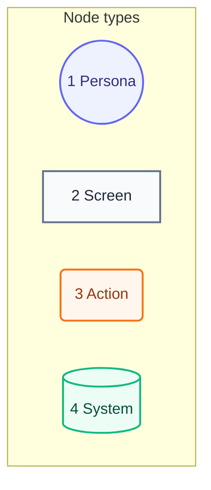
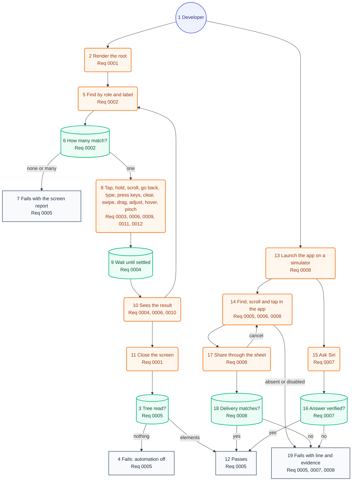

# User Journey

## Legend

Numbers match the callout table.

| #   | Description | Why                                      |
| --- | ----------- | ---------------------------------------- |
| 1   | Persona     | A person the system context declares.    |
| 2   | Screen      | What the person sees.                    |
| 3   | Action      | What the person does.                    |
| 4   | System      | What the product does in reply.          |

## Journey

A developer writes one test as a person's steps. A hosted test renders the app root, then a `User` looks and acts until the test's claim holds. A system test launches the app instead and drives Siri or the share sheet. Each step waits on a condition, and any failure names the test's line ([03-components.md](03-components.md)).

Each step's label ends with the requirement docs it fulfils, by ID.

Numbers match the callout table. See [03-components.md](03-components.md) and [04-code.md](04-code.md).

| #   | Description | Type | Why |
| --- | ----------- | ---- | --- |
| 1   | Developer: Writes a test in a consumer target. | Persona | The one actor of this journey. |
| 2   | Render the root: `Screen.render` draws the app's real root in a fixed-size key window of the iOS or Mac host. | Action | The app's own composition runs ([ADR 0006](adr/0006-one-api-two-backends.md)). |
| 3   | Tree read?: At teardown the canary asks whether any read found elements. | System | Catches an empty tree on every test ([ADR 0004](adr/0004-automation-canary.md)). |
| 4   | Fails: automation off: The test fails saying VoiceOver read nothing. | Screen | A silent pass would prove nothing. |
| 5   | Find by role and label: A query resolves against the current tree. | Action | Role and label first ([ADR 0002](adr/0002-query-priority.md)). |
| 6   | How many match?: One, none, or many, polled up to the deadline. | System | An ambiguous match is a failure, as in Testing Library. |
| 7   | Fails with the screen report: Names the query, then lists what is on and off screen. | Screen | The fix starts from what a person hears. |
| 8   | Tap, hold, scroll, go back, type, press keys, clear, swipe, drag, adjust, hover, pinch: Acts through activation, custom actions, scrolling, escape, the keyboard and its keys, the clipboard, or pointer events made in process. A disabled control fails the act. | Action | VoiceOver's own entry points ([ADR 0007](adr/0007-control-state.md)). |
| 9   | Wait until settled: Lets the main run loop go idle twice, then reads once, with animations off. | System | No sleeps ([ADR 0003](adr/0003-condition-waits.md)). |
| 10  | Sees the result: Waits until the expected element shows, or stays gone, and reads its enabled state. It can also watch for a set time, time stalls, or find the share sheet. | Action | The claim is about the screen. |
| 11  | Close the screen: Hides the window and releases the root. | Action | The next test gets a fresh window ([ADR 0005](adr/0005-one-window-per-process.md)). |
| 12  | Passes: The test ends green once its tree was read, or once the system check holds. | Screen | Only a test that read the screen proves anything. |
| 13  | Launch the app on a simulator: A `SystemSession` launches the app from a UI-test target, run by `make requirements-e2e`. | Action | System UI runs outside the app's process ([ADR 0009](adr/0009-system-sharing.md)). |
| 14  | Find, scroll and tap in the app: The session waits for one match, scrolls to it, and taps it. | Action | The same queries and failures as hosted tests. |
| 15  | Ask Siri: Submits a phrase and captures the visible transcript. | Action | Siri answers outside the app ([ADR 0008](adr/0008-siri-system-requests.md)). |
| 16  | Answer verified?: Checks the expected answer and forbidden text in a verified answer. | System | Unverified text stays indeterminate. |
| 17  | Share through the sheet: Picks the local destination in the real share sheet, or cancels. | Action | No message reaches a contact. |
| 18  | Delivery matches?: Checks the received message and the image's visible text with Vision. | System | Only received bytes prove what was shared. |
| 19  | Fails with line and evidence: Names the test's line, with the screen, the transcript, or the received items. | Screen | The fix starts from what the system showed. |
