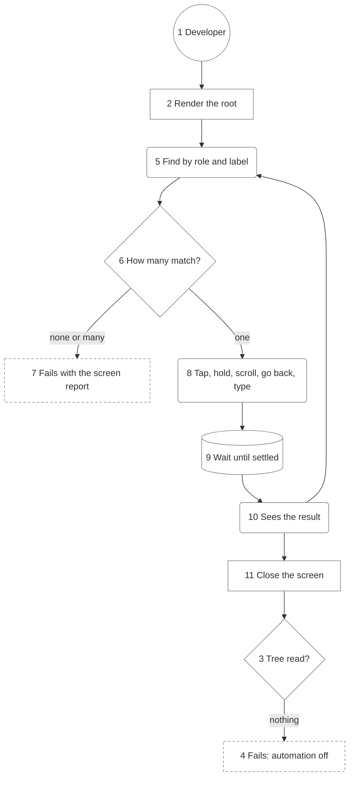

# User Journey

## Core journey

A developer writes one test as a person's steps. It renders the app root, then a `User` looks and acts until the test's claim holds. Each step waits on a condition, and any failure prints what VoiceOver reads ([03-components.md](03-components.md)).

Numbers match the callout table. See [03-components.md](03-components.md) and [04-code.md](04-code.md).

| #   | Node | Description | Why |
| --- | ---- | ----------- | --- |
| 1   | Developer | Writes a test in a consumer target. | The one actor of this journey. |
| 2   | Render the root | `Screen.render` draws the app's real root in a phone-sized key window. | The app's own composition runs. |
| 3   | Tree read? | At teardown the canary asks whether any read found elements. | Catches an empty tree on every test ([ADR 0004](adr/0004-automation-canary.md)). |
| 4   | Fails: automation off | The test fails saying VoiceOver read nothing. | A silent pass would prove nothing. |
| 5   | Find by role and label | A query resolves against the current tree. | Role and label first ([ADR 0002](adr/0002-query-priority.md)). |
| 6   | How many match? | One, none, or many, polled up to the deadline. | An ambiguous match is a failure, as in Testing Library. |
| 7   | Fails with the screen report | Names the query, then lists what is on and off screen. | The fix starts from what a person hears. |
| 8   | Tap, hold, scroll, go back, type | Acts through activation, custom actions, scrolling, escape, or the keyboard. | VoiceOver's own entry points. |
| 9   | Wait until settled | Polls until the tree stops changing, with animations off. | No sleeps ([ADR 0003](adr/0003-condition-waits.md)). |
| 10  | Sees the result | Waits until the expected element shows, or stays gone. | The claim is about the screen. |
| 11  | Close the screen | Hides the window and releases the root. | The next test gets a fresh window ([ADR 0005](adr/0005-one-window-per-process.md)). |
